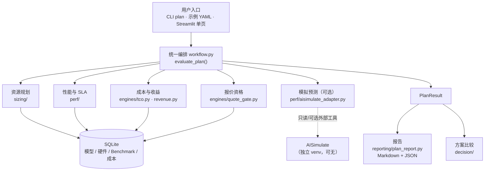

# 系统总体架构（S1）

**对象**：Model_configurater 推理容量与部署方案系统
**基线**：V7.0 F6 封板（核心计算、模拟搜索、推荐逻辑已冻结）
**定位**：本文件描述**现有代码的实际结构**，不是理想架构。

---

## 1. 一句话架构

> **一个模块化单体（modular monolith）**：一个 Python 包 + 一个 SQLite 库 + 一个
> `PlanRequest → PlanResult` 契约。四个业务领域（资源规划 / 性能与 SLA / 成本与收益 /
> 报价资格）在同一进程内按顺序执行，模拟预测作为**可选**的第五个输入挂在旁边。

没有微服务、没有消息队列、没有独立的前端后端拆分。

## 2. 总体结构



ASCII 备份（图不便渲染时看这个）：

```
用户入口 (CLI / YAML / Streamlit)
        │
        ▼
  workflow.evaluate_plan()  ────────────────┐
        │                                   │
        ├─► sizing/        资源规划          │
        ├─► perf/          性能与 SLA        │  只读 SQLite
        ├─► engines/tco    成本与收益        │
        ├─► engines/quote_gate 报价资格      │
        └─► perf/aisimulate_adapter 模拟（可选）─► 外部 AISimulate（可无）
        │
        ▼
   PlanResult ──► reporting/plan_report.py ──► Markdown / JSON
             └─► decision/ 方案比较
```

## 3. 组件职责与边界

| 组件 | 目录 | 职责 | 输入 → 输出 |
|---|---|---|---|
| **统一编排** | `workflow.py` | 唯一应用入口；按领域顺序执行、收集状态与缺口 | `PlanRequest` → `PlanResult` |
| **资源规划** | `sizing/` | 权重/KV 显存、TP/DP 组合、静态可行性 | 模型规格 + 硬件 + 假设 → 候选与 `feasibility.status` |
| **性能与 SLA** | `perf/` | Benchmark 匹配、容量分析、SLA 判定、现场校验 | 候选 + 实测池 → 匹配等级 / `sla_status` |
| **成本与收益** | `engines/tco.py`, `revenue.py` | TCO、收入区间、预算比对 | 成本目录 + 部署形状 → `TCO` / 收入 |
| **报价资格** | `engines/quote_gate.py` | 四维门禁（成本/SLA/商务/审批） | 证据引用 → `quote_publishable` |
| **模拟预测** | `perf/aisimulate_adapter.py` | 解析 AISimulate 输出；可选自动搜索 + P99 回放 | 需求 → `SimulationResult`（`sim_*` 字段） |
| **方案比较** | `decision/` | 成本可比性、预算敏感性 | 候选集 → 比较结论 |
| **报告** | `reporting/` | Markdown / JSON 渲染 | `PlanResult` → 文档 |
| **存储** | `storage/` + `schemas/` | SQLite 仓储与全部数据契约 | — |
| **导入器** | `importers/` | Excel / Benchmark / 成本目录 / 官方清单 | 原始文件 → 库内记录 |
| **兼容层** | `services.py`, `cli.py`, `agent_api.py` | 旧命令入口与 Agent 只读接口 | — |

### 三条不可越过的边界

1. **实测与模拟结构隔离**：模拟数据只存在于 `schemas/simulation.py` 的对象里，
   指标一律 `sim_*` 前缀；不写 `BenchmarkRun` / `CapacityPoint`，
   `predicted_*` 永不转换为 `observed_*`。
2. **价格与证据不编造**：缺数据保持 `None`/`unknown`，未知不等于 0；
   报价资格只认持久化证据引用。
3. **生产报价禁用**：未接入可信审批系统，正式发布恒为"未授权"。

## 4. 数据流：从用户输入到方案文档

```
① 需求输入        PlanRequest（YAML / CLI 参数 / 表单）
                 model_id · hardware_ids · max_total_gpus · workload(isL/OSL/并发)
                 sla(P99 阈值) · cost(模板) · budget · advanced(精度/框架)
        │
② 数据准备        import-models / import-hardware / import-cost-catalog
                 import_public_benchmarks.py（公开参考，逐字段核对）
        │
③ 资源规划        sizing: 每个 (tp, dp) → 是否装得下、需要几张卡
        │
④ 性能与 SLA      perf: 库内实测匹配 → 匹配等级与 SLA 状态
                 若开启 simulation: 扫描器搜索 → 资源过滤 → Top-N → 原生 P99
        │
⑤ 成本与预算      engines/tco: 成本模板 → TCO（不完整则不给总额）
                 decision/sensitivity: 预算比对（币种未确认 → unknown）
        │
⑥ 资格与比较      quote_gate: 四维门禁；decision: 成本可比性
        │
⑦ 输出            PlanResult → Markdown（人读）+ JSON（机器读）
```

## 5. 已实现 / 未实现（如实对照）

| 能力 | 状态 |
|---|---|
| 模型显存与 TP/DP 资源规划 | ✅ 已实现 |
| Benchmark 匹配与实测 SLA 判定 | ✅ 已实现 |
| TCO / 预算 / 收入区间 | ✅ 已实现 |
| 报价四维门禁 | ✅ 已实现（生产发布禁用） |
| 公开数据导入（逐字段核对） | ✅ 已实现 |
| AISimulate 输出解析（扫描器 / 原生 P99） | ✅ 已实现 |
| 自动搜索 → 资源过滤 → Top-N → P99 回放 | ✅ 已实现（需外部工具） |
| 推荐资格（身份/资源/P99/预算） | ✅ 已实现 |
| 统一报告（技术版） | ✅ 已实现 |
| **一份需求 → 一键出方案（离线可复现）** | 🟡 本阶段实现（S2） |
| **单页业务界面** | 🟡 本阶段实现（S3） |
| 客户版方案文档（7 段式） | 🟡 本阶段实现（S4） |
| 自然语言 Agent 模式（Command Code + MCP） | ✅ 已实现（V/W/X） |
| Agent 任务身份绑定 + 运行沙箱 | ✅ 已实现（X1） |
| Agent 模式受控部署 | ❌ 未实施（X5 仅设计） |
| 目标配置的真实性能验证 | ❌ 未实现（需 N6 真机） |
| 真实 GPU 压测 / 审批系统接入 | ❌ 未实现（不在本阶段范围） |

## 6. AI Agent 的接入位置（已实现）

**允许**：理解自然语言需求、选择工具、组织步骤、生成解释性文字。

**禁止**：修改任何数值、证据类型、推荐资格；不得自行判断“达标”。

**实现**（Command Code + 本地 MCP，V/W/X 阶段）：

```
Streamlit（手动 / Agent）
  → AgentService
  → command-code -p（bwrap 文件系统沙箱）
  → MCP server（lcp）
  → tool_cli → evaluate_plan() → PlanResult → Reporting
```

- 三个工具：`get_platform_catalog`、`evaluate_deployment_plan`、
  `get_plan_report(task_id, run_id)`；
- `task_id / run_id / result_sha256 / 运行目录契约` 强绑定；
- Agent 会话状态与业务报告状态分开；
- 运行时只允许精确的三个 MCP 工具（外加搜索元工具），其余调用判失败；
- 沙箱不暴露 `data/private`、`data/local.db`、raw xlsx 与真实 HOME；
- 模型文本只作解释，报告始终来自结构化产物；
- 无 Command Code/模型时，手动模式完全不受影响。

OpenCode 作为备选 transport 保留（服务端 free tier 与自定义工具暴露仍有阻塞）。
Agent 模式未部署到无鉴权的 `compute01` 页面。
